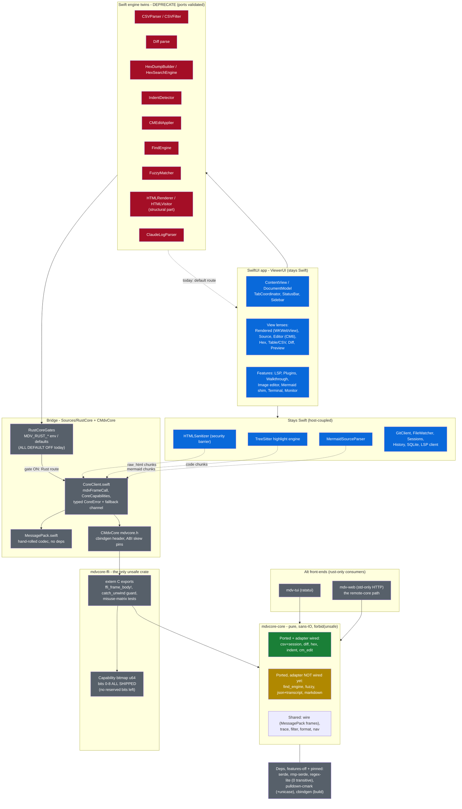
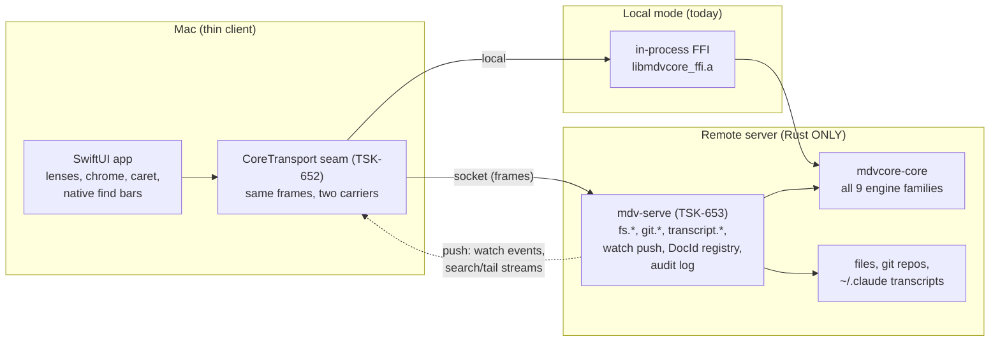

# TextView / MarkdownViewer — layer map (2026-06-12)

Color key: **green** = Rust engine validated **and** adapter+gate wired ·
**yellow** = Rust engine validated, adapter/gate **not yet wired** ·
**red** = Swift twin slated for deprecation · **blue** = stays Swift
(host-coupled) · **gray** = infrastructure.

> All `MDV_RUST_*` gates currently **default OFF** — the shipping app still
> routes every engine through Swift. Flipping defaults (after soak) and then
> deleting the red twins IS the deprecation path.

## Where each engine stands

| Engine | Rust module | Capability bit | Adapter | Gate (`MDV_RUST_*`) | Default |
|---|---|---|---|---|---|
| CSV session | `csv`+`session` | 1<<0 | `RustCSVAdapter` | `MDV_RUST_CSV` | OFF |
| Diff | `diff` | 1<<1 | `RustDiffAdapter` | `MDV_RUST_DIFF` | OFF |
| Hex render | `hex` | 1<<2 | `RustHexAdapter` | `MDV_RUST_HEX` | OFF |
| Hex search | `hex` | 1<<2 | `RustHexSearchAdapter` | `MDV_RUST_HEXSEARCH` | OFF |
| Indent | `indent` | 1<<3 | `RustIndentAdapter` | `MDV_RUST_INDENT` | OFF |
| CM edit apply | `cm_edit` | 1<<4 | wrapper only | `MDV_RUST_CMEDIT` (case exists) | OFF |
| Find | `find_engine` | 1<<5 | **none yet** (TSK-645) | **no gate case yet** | — |
| Markdown | `markdown` | 1<<6 | **none yet** (TSK-648) | **no gate case yet** | — |
| Transcript | `json`+`transcript` | 1<<7 | **none yet** (TSK-647) | **no gate case yet** | — |
| Fuzzy | `fuzzy` | 1<<8 | **none yet** (TSK-646) | `MDV_RUST_FUZZY` (case exists) | OFF |

## Deprecation path (Swift core → Rust core)

1. **Wire the four new adapters** — TSK-645 (find), TSK-646 (fuzzy),
   TSK-647 (transcript), TSK-648 (markdown incl. chunk splice; sanitizer /
   mermaid / TreeSitter stay Swift-side by design). Fallback-on-`CoreError`
   like the CSV beachhead.
2. **Flip gate defaults ON per engine and soak** (TSK-649 stage A) — env
   override still pins either side for A/B; the parity suites are the
   regression net.
3. **Bake in** (TSK-649 stage B, owner-gated per engine): remove the gates,
   delete the red twins, retarget twin-coupled tests. Swift core shrinks to
   the blue host-coupled set; `mdvcore-core` becomes the single engine layer —
   the same one `mdv-web` serves remotely.

> Mermaid rendering glitch in this doc is tracked as TSK-650 (parked by owner
> directive).

---

# Remote operation (owner target 2026-06-12): Rust-only server, thin Swift UI

**What the Swift app calls "core" today is ONLY the engine families above.**
Everything else is Swift-local — and that's the real gap for remote:

| Surface | Today (Swift-local) | Remote requirement | Ticket |
|---|---|---|---|
| File read | `TextFileLoader` / `BinaryFileLoader` | `fs.read` **windowed** (offset+len; a 500 MB file never ships whole) | TSK-654 |
| File tree / sidebar | `FileTreeService` | `fs.tree` / `fs.readdir` with listing caps + root containment | TSK-654 |
| File watching | `FileWatcher` (FSEvents) | `fs.watch` **server-push** events — needs a duplex channel, not request/response | TSK-655 |
| Cross-file search | `CrossFileSearch` | host-layer orchestration over `find_engine`, streamed results | TSK-656 |
| Git | `GitClient` (spawns local git) | `git.*` family server-side (spawn server's git; no libgit2 dep) | TSK-657 |
| Transcript discovery + tail | `FileManager` + Swift tail | `transcript.list/follow` on the server; redaction enforced at the WIRE | TSK-658 |
| LSP / Terminal | local processes | server-side LSP proxy / remote PTY — hardest, spiked separately | TSK-659 |
| In-document find bars | WKWebView / NSTextView / CM6 native search | stays client-side (it searches what's on screen) | — |

The engine layer (`mdvcore-core`) is deliberately **sans-IO** — that stays.
IO lives in a Rust **host layer**: locally that's the Swift app feeding bytes
through FFI; remotely it's **`mdv-serve`** (TSK-653) doing its own IO where
the files live. `mdv-web` already proves the shape (it browses/reads/searches
in pure Rust) — but it serves HTML to humans; `mdv-serve` speaks the SAME
MessagePack frames the FFI speaks, to the Swift thin client over a socket.

**Why the adapter-flip wave (TSK-645–649) is still the critical path:** the
transport seam only helps if every consumer already routes through the
adapters. Flip order: adapters → `CoreTransport` → `mdv-serve` + `fs` family →
watch/push → git/transcript → LSP/terminal spike. Epic: **TSK-651**.
