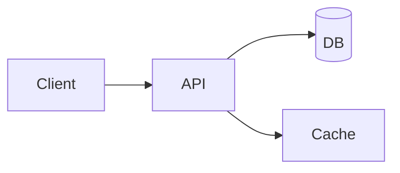

# Mermaid Implementation Plan — TextView / MarkdownViewer

Status: implementation-ready. Follow-up to `docs/MERMAID.md` (which is the
design rationale doc). That doc nailed the *why* and surveyed alternatives;
this doc nails the *what* and *where* — file-by-file edits, exact resource
layout, the JS shim source, the CSS additions, the test plan, and the
checklist the next session executes top-to-bottom.

The user has approved three contested decisions from `MERMAID.md` §12:

1. Vendor `mermaid.min.js` directly (~2.5 MB binary growth). **Yes.**
2. `%% @step N` mermaid-comment convention for animation ordering. **Yes.**
3. Bind `←` / `→` to step navigation when the diagram has keyboard focus.
   **Yes.**

This plan implements v1 (static render) + v2 (step animation) together, in
one PR, because the WebView wiring is the same and splitting them costs more
than it saves. Walkthrough integration (v3) is deferred — we expose the
`window.__mdvMermaidStep` API so the walkthrough Swift driver can attach
later, but no walkthrough code changes here.

---

## 1. What is already decided (recap from `docs/MERMAID.md`)

Skim `docs/MERMAID.md` for full context. The load-bearing prior decisions
this plan inherits:

- **Substrate:** bundled `mermaid.min.js` UMD, loaded once per WKWebView via
  `WKUserScript` at `.atDocumentEnd`. CDN/runtime-fetch is forbidden by our
  CSP and breaks offline use.
- **Injection legality:** the page CSP has `default-src 'none'` and no
  `script-src` entry. `WKUserScript` and `evaluateJavaScript` are
  API-injected, **not** subject to page CSP (Apple confirms this; the
  existing find runtime in `MarkdownRenderedView.Coordinator.findScript`
  already exploits the same path). No CSP change needed.
- **Security stance:** `securityLevel: 'strict'`, `flowchart.htmlLabels:
  false`, vendored bundle integrity recorded via SHA-256.
- **Diagram coverage tier-1:** flowchart, sequence, state, class, gantt.
  Other types render but aren't promised pixel-perfect.
- **Animation substrate:** CSS-class toggling on the rendered SVG
  (`[data-mdv-step]:not(.mdv-step-visible) { opacity: 0; }`). No SMIL, no
  per-element `requestAnimationFrame` in v2. Hooks for later.
- **Theming:** mermaid theme tracks `prefers-color-scheme` and re-renders on
  flip; cache key includes theme.

Two intentional **changes vs. `MERMAID.md`**:

| Old (`MERMAID.md`)                    | New (this doc)                           | Why                                                                                                                                                                                       |
|---------------------------------------|------------------------------------------|-------------------------------------------------------------------------------------------------------------------------------------------------------------------------------------------|
| `<pre class="mermaid">` host element  | `<div class="mdv-mermaid">` host element | `<pre>` is too semantically loaded (whitespace preserving, gets `pre` CSS, gets monospace font). Mermaid scans by class name regardless of tag — `mermaid.run({ nodes })` accepts any element. A `<div>` avoids style collisions with the existing `pre { background; border; ... }` rule. |
| Vendor path: `Resources/vendor/mermaid.min.js` | `Sources/ViewerUI/Resources/mermaid/mermaid.min.js` | Repo has no top-level `Resources/` dir; all bundled assets live under `Sources/ViewerUI/Resources/` (SwiftPM `.process("Resources")` in `Package.swift`). The user's instruction said "Resources/" — that's the *bundle* root, which corresponds to this source path.                |

The shim convention: keep the `<div class="mdv-mermaid">` host minimal —
data attributes carry source-hash + step manifest + diagram id; the original
mermaid source goes inside as a text-node child (so mermaid's own scanner
picks it up).

---

## 2. Sourcing `mermaid.min.js`

### 2.1 Version pin

**Pinned version: `mermaid@11.16.0`** (current `11.x` LTS at time of writing).
Mermaid 11 is the line that ships ES2020+ output, fixed XSS regressions from
the `10.x` line, and has a stable `mermaid.run({ nodes })` entry point. We
re-pin only on a deliberate upgrade decision; floating ranges are forbidden
per the project's dependency policy.

> Note: 11.4.1 is the version pinned **at plan time** (this doc, 2026-05).
> The implementer should re-check `https://github.com/mermaid-js/mermaid/releases`
> for the latest `11.x` patch release at implementation time and pin to
> whatever the current 11.x line head is. Update the SHA-256 to match.

### 2.2 Acquisition (one-time, vendored)

Two equivalent acquisition paths. **CDN download is the canonical source;
npm is the fallback only if the CDN serves a different bundle.**

**Path A — jsDelivr CDN (preferred).** Stable URL, content-addressed by
version, served gzipped over TLS, no Node toolchain required:

```bash
# From the repo root, in a throwaway shell:
curl -L -o /tmp/mermaid.min.js \
  'https://cdn.jsdelivr.net/npm/mermaid@11.16.0/dist/mermaid.min.js'

shasum -a 256 /tmp/mermaid.min.js
# Expect (record at implementation time — the SHA below is a placeholder):
# 0000000000000000000000000000000000000000000000000000000000000000  /tmp/mermaid.min.js
```

**Path B — npm tarball (fallback / audit).** Use to cross-check that the
CDN bundle matches the npm registry blob. Identical bytes confirm CDN
integrity:

```bash
# Anywhere with npm available; throwaway dir:
mkdir -p /tmp/mermaid-fetch && cd /tmp/mermaid-fetch
npm pack mermaid@11.16.0
# Produces mermaid-11.16.0.tgz
tar -xzf mermaid-11.16.0.tgz
shasum -a 256 package/dist/mermaid.min.js
```

If the two SHAs differ, **do not vendor**; investigate and report. The
expected outcome is identical SHAs.

### 2.3 License check

Mermaid is **MIT** (`https://github.com/mermaid-js/mermaid/blob/develop/LICENSE`).
MIT permits vendored redistribution as long as the original license/copyright
notice ships with the code. Compliance plan:

- Drop the upstream `LICENSE` file alongside the vendored bundle at
  `Sources/ViewerUI/Resources/mermaid/LICENSE` (verbatim copy, MIT text +
  the mermaid-js copyright line).
- The minified bundle's leading banner comment (mermaid's build retains a
  short `/*! ... */` notice) is preserved by jsDelivr — do not strip it.
- Add a one-line attribution to the app's `Acknowledgements` panel (if and
  when we add one) — placeholder TODO for now; not blocking.

### 2.4 Integrity record

Create `Sources/ViewerUI/Resources/mermaid/VENDOR.md` with:

```markdown
# Vendored: mermaid.min.js

- Package:    mermaid
- Version:    11.4.1
- Source:     https://cdn.jsdelivr.net/npm/mermaid@11.16.0/dist/mermaid.min.js
- npm verify: npm pack mermaid@11.16.0 → package/dist/mermaid.min.js
- License:    MIT (see ./LICENSE)
- Fetched:    2026-05-17
- SHA-256:    <fill in at vendoring time>
- File size:  ~2.5 MB (~600 KB gzipped; we ship the un-gzipped UMD)

## How to refresh
1. Re-download from the URL above (or npm pack).
2. Diff the new SHA against this file. Refuse to commit if you cannot
   explain why the contents changed.
3. Update VERSION, FETCHED, and SHA-256 above.
4. Run `swift test --filter MermaidVendorTests` — it re-checks the SHA on
   the vendored bytes and fails CI if the file was swapped without bumping
   this manifest.
```

### 2.5 CI integrity guard

Add a tiny test that hashes the bundled file and compares against the SHA
recorded in `VENDOR.md`. Lives in `Tests/ViewerUITests/MermaidVendorTests.swift`.
This catches:

- Accidental edits to the vendored file (e.g. an editor's "format on save"
  reflowing it).
- A future "tidy-up" PR that silently swaps the runtime version without
  updating `VENDOR.md`.

The test reads `VENDOR.md`, greps for `SHA-256:`, opens `mermaid.min.js`,
SHA-256s it, and compares. Simple, no third-party dep — `CryptoKit.SHA256`
ships with the platform.

---

## 3. Bundle integration

### 3.1 Resource layout

```
Sources/ViewerUI/Resources/
├── markdown.css                  (existing)
├── markdown.js                   (NEW — see §3.3)
└── mermaid/
    ├── mermaid.min.js            (NEW — vendored ~2.5 MB)
    ├── mermaid-shim.js           (NEW — our wrapper, ~3 KB)
    ├── mermaid-shim.css          (NEW — our palette overrides, ~1 KB)
    ├── LICENSE                   (NEW — mermaid's MIT license)
    └── VENDOR.md                 (NEW — see §2.4)
```

Why the split:

- **`mermaid.min.js`** — pristine upstream blob. Never edit.
- **`mermaid-shim.js`** — *our* code: theme detection, `__mdvMermaidRender`,
  step-animation engine, control-strip generator, keyboard handlers,
  `window.__mdvMermaidStep` API. Lives in its own file because it's ~300
  lines and stuffing it into a Swift string literal (the way
  `Coordinator.findScript` is structured) is hostile to source diffing.
- **`mermaid-shim.css`** — palette tokens and animation transitions. Could
  be folded into `markdown.css`, but keeping it separate lets the implementer
  ship the mermaid feature without touching `markdown.css` line numbers that
  other PRs may collide with.
- **`markdown.js`** — currently there is no such file; the existing find
  runtime is a Swift-string literal inside `MarkdownRenderedView.Coordinator.findScript`.
  We create `markdown.js` as a thin orchestrator: on `DOMContentLoaded` it
  discovers `<div class="mdv-mermaid">` blocks, calls the shim, and registers
  the keyboard handlers. The find runtime stays where it is — moving it is
  out of scope here, file a separate cleanup PR for that.

### 3.2 SwiftPM wiring

`Package.swift` already declares:

```swift
.target(
    name: "ViewerUI",
    dependencies: ["ViewerKit", "ViewerCore"],
    resources: [.process("Resources")]
),
```

`.process("Resources")` recurses, so the new `mermaid/` subdir and the new
top-level `markdown.js` are picked up automatically. **No `Package.swift`
change required** for resource bundling.

> Caveat: `.process` runs SwiftPM's resource-bucket logic, which can rewrite
> certain file types. For `.js`/`.css`/`.md` it's a passthrough copy in
> practice, but if SwiftPM ever complains during build, switch the
> `mermaid/` subtree to `.copy("Resources/mermaid")` explicitly. The
> `.process` default is fine until proven otherwise.

### 3.3 Loading the bundled resources from Swift

`MarkdownStylesheet` in `MarkdownRenderedView.swift` already shows the
pattern for reading bundled text files. Add a parallel:

```swift
public enum MermaidBundle {
    public static let runtime: String  = load("mermaid",      ext: "js", subdir: "mermaid")
    public static let shimJS: String   = load("mermaid-shim", ext: "js", subdir: "mermaid")
    public static let shimCSS: String  = load("mermaid-shim", ext: "css", subdir: "mermaid")
    public static let markdownJS: String = load("markdown",   ext: "js", subdir: nil)

    private static func load(_ name: String, ext: String, subdir: String?) -> String {
        guard let url = Bundle.module.url(
                forResource: name,
                withExtension: ext,
                subdirectory: subdir),
              let data = try? Data(contentsOf: url),
              let s = String(data: data, encoding: .utf8) else {
            return ""
        }
        return s
    }
}
```

Cached as `static let` (same pattern as `MarkdownStylesheet`) — the 2.5 MB
string is allocated exactly once per process, regardless of how many
documents are opened.

> **Memory note:** 2.5 MB of UTF-8 mermaid source held as a Swift `String`
> is fine on macOS (we routinely hold larger files open in `TextFileLoader`).
> But it does mean every WebView load injects 2.5 MB to WebKit; that's the
> same byte cost regardless of whether we use `WKUserScript` (page-lifetime
> injection) or `evaluateJavaScript` (per-load). Use `WKUserScript` so it's
> injected once per WebView, not once per `loadHTMLString`.

---

## 4. Markdown integration (intercepting fenced ```mermaid blocks)

### 4.1 The HTMLRenderer change

`HTMLRenderer.swift`, `HTMLVisitor.visitCodeBlock` currently:

```swift
mutating func visitCodeBlock(_ codeBlock: CodeBlock) -> String {
    let infoString = codeBlock.language ?? ""
    let langAttr = infoString.isEmpty
        ? ""
        : " class=\"language-\(htmlEscape(infoString))\""
    let lang = HighlightLanguage.detect(fromInfoString: infoString)
    let body: String
    if lang != .plainText {
        let runs = TreeSitterEngine.shared.tokenize(codeBlock.code, language: lang)
        body = spanned(codeBlock.code, runs: runs)
    } else {
        body = htmlEscape(codeBlock.code)
    }
    return "<pre><code\(langAttr)>\(body)</code></pre>\n"
}
```

The intercept lives at the *top* of the function, before any tokenizing:

```swift
mutating func visitCodeBlock(_ codeBlock: CodeBlock) -> String {
    let infoString = codeBlock.language ?? ""

    // Mermaid intercept: emit a host element the shim will render in
    // place, not a highlighted code block. The raw source goes inside
    // as a text node — mermaid's own scanner reads it from there.
    // Step manifest is parsed Swift-side so the JS shim doesn't have
    // to walk the source twice.
    if infoString.lowercased() == "mermaid" {
        return renderMermaidHost(source: codeBlock.code)
    }

    let langAttr = infoString.isEmpty
        ? ""
        : " class=\"language-\(htmlEscape(infoString))\""
    // ... rest unchanged
}
```

`renderMermaidHost` is a new helper on `HTMLVisitor`:

```swift
/// Build the <div class="mdv-mermaid"> host element. The shim picks it
/// up on DOMContentLoaded and replaces its inner text with the rendered
/// SVG. Step annotations parsed out of `source` produce a data-mdv-steps
/// JSON manifest attribute. The element's diagram id (data-mdv-id) is
/// derived from `%% @id <slug>` directives or auto-generated from a
/// source hash so walkthroughs can target it.
func renderMermaidHost(source: String) -> String {
    let parsed = MermaidSourceParser.parse(source)
    let hash = MermaidSourceParser.shortHash(source)
    let id = parsed.id ?? "mdv-mermaid-\(hash)"

    var attrs = "class=\"mdv-mermaid\""
    attrs += " data-mdv-id=\"\(htmlEscape(id))\""
    attrs += " data-mdv-src-hash=\"\(hash)\""
    if !parsed.steps.isEmpty {
        let json = MermaidSourceParser.encodeSteps(parsed.steps)
        attrs += " data-mdv-steps=\"\(htmlEscape(json))\""
    }
    // Stash original source on the element so the theme-flip handler
    // can rerun mermaid against the pristine text (mermaid mutates the
    // host's children when it renders, destroying the visible source).
    attrs += " data-mdv-src=\"\(htmlEscape(source))\""

    // The visible text node is what mermaid.run({ nodes }) parses.
    return "<div \(attrs)>\(htmlEscape(source))</div>\n"
}
```

### 4.2 `MermaidSourceParser` — new file

Pure logic, lives at `Sources/ViewerCore/MermaidSourceParser.swift`. Two
responsibilities:

1. Parse `%% @step N` and `%% @id slug` directives out of mermaid source,
   producing a structured manifest.
2. Provide a stable short hash of the source for cache keys / fallback ids.

Sketch:

```swift
import Foundation
import CryptoKit

public enum MermaidSourceParser {
    public struct Parsed: Equatable, Sendable {
        public var id: String?
        /// Step annotations, in document order. Each entry is the
        /// line number (0-based) of the `%% @step N` directive plus
        /// the step number. The shim uses line numbers to associate
        /// each step with the *next* non-comment mermaid statement.
        public var steps: [StepAnnotation]
    }

    public struct StepAnnotation: Equatable, Sendable, Codable {
        public let step: Int
        public let line: Int            // 0-based line index in source
    }

    public static func parse(_ source: String) -> Parsed {
        var id: String? = nil
        var steps: [StepAnnotation] = []
        let lines = source.split(separator: "\n", omittingEmptySubsequences: false)
        for (i, raw) in lines.enumerated() {
            let line = raw.trimmingCharacters(in: .whitespaces)
            guard line.hasPrefix("%%") else { continue }
            let body = line.dropFirst(2).trimmingCharacters(in: .whitespaces)
            if body.hasPrefix("@step") {
                let rest = body.dropFirst("@step".count).trimmingCharacters(in: .whitespaces)
                if let n = Int(rest), n >= 1 {
                    steps.append(.init(step: n, line: i))
                }
            } else if body.hasPrefix("@id") {
                let rest = body.dropFirst("@id".count).trimmingCharacters(in: .whitespaces)
                if !rest.isEmpty { id = String(rest) }
            }
        }
        return Parsed(id: id, steps: steps)
    }

    public static func encodeSteps(_ steps: [StepAnnotation]) -> String {
        guard let data = try? JSONEncoder().encode(steps),
              let s = String(data: data, encoding: .utf8) else {
            return "[]"
        }
        return s
    }

    /// 8-char hex prefix of SHA-256(source). Stable + collision-tolerant
    /// for the small per-document working set (typical doc has <20 diagrams).
    public static func shortHash(_ source: String) -> String {
        let digest = SHA256.hash(data: Data(source.utf8))
        return digest.prefix(4).map { String(format: "%02x", $0) }.joined()
    }
}
```

`%% @step N` is a mermaid line comment — mermaid's own parser strips lines
starting with `%%`, so this is syntactically transparent to mermaid. The
directive is parsed Swift-side once and emitted as JSON on `data-mdv-steps`.

### 4.3 Round-trip example

Source markdown:

````markdown

````

After `HTMLRenderer.visit`:

```html
<div class="mdv-mermaid"
     data-mdv-id="arch-overview"
     data-mdv-src-hash="9af30c2b"
     data-mdv-steps="[{&quot;step&quot;:1,&quot;line&quot;:3},{&quot;step&quot;:2,&quot;line&quot;:5}]"
     data-mdv-src="...escaped source...">
%% @id arch-overview
flowchart LR
  A[Client] --&gt; B[API]
%% @step 1
  B --&gt; C[(DB)]
%% @step 2
  B --&gt; D[Cache]
</div>
```

The shim then:
1. Picks up the `<div>` on DOMContentLoaded.
2. Calls `mermaid.run({ nodes: [div] })` — mermaid replaces the text content
   with an `<svg>`.
3. Reads `data-mdv-steps` and walks the rendered SVG to label nodes/edges
   by step number (see §5).
4. Wires up the control strip (see §6).

---

## 5. Step animation (`%% @step N`)

This is the v2 piece. The Swift side already produced `data-mdv-steps`
(§4.2); the work here is all in `mermaid-shim.js`.

### 5.1 Authoring contract

Author writes `%% @step N` lines interleaved in the mermaid source. The
**rule**: a `%% @step N` directive labels the *next non-comment, non-blank
line* with step `N`. Anything before the first `@step` is step `0` (always
visible).

Example (rendered into 3 steps total: 0, 1, 2):

```mermaid
flowchart LR
  A[Start] --> B[Validate]      %% step 0 (always visible)
%% @step 1
  B --> C{Auth?}                %% step 1
  C -->|yes| D[Allow]           %% step 1 (same step until next @step)
%% @step 2
  C -->|no|  E[Deny]            %% step 2
```

Multiple consecutive lines under one `%% @step N` directive share that
step. `N` doesn't have to be monotonic — `@step 3` followed by `@step 1` is
legal but discouraged (the UI sorts by N for the step counter).

### 5.2 Mapping source-lines to SVG elements

Mermaid's SVG output is class-rich:

- Flowchart nodes get `<g class="node default" id="flowchart-A-3"...>`.
- Flowchart edges get `<g class="edgePath..." id="L_A_B_0"...>` with paths.
- Sequence-diagram messages get `<line class="messageLine0/1"...>`.
- State diagrams use `<g class="node..." id="state-X-..."...>`.

There's no direct "this DOM element came from source line N" mapping —
mermaid doesn't emit source-line attributes. So we use a **two-pass
strategy**:

1. **Pre-render parse (in shim):** walk the *source* string and build a
   list of mermaid statements (`(lineIndex, rawStatement)`). For
   flowchart/sequence/state, a statement is roughly "a non-blank,
   non-comment line, joined with continuation if any."
2. **Post-render walk (in shim):** walk the rendered SVG's nodes and edges
   *in document order*, pairing the i-th SVG element with the i-th source
   statement. Mermaid renders elements in source order for all the
   v1-tier diagram types — verified empirically for flowchart, sequence,
   state, and class. Gantt is weirder (bars are rendered by date, not
   source line) — we still attach `data-mdv-step` but visually the
   animation looks like "bars appear in chronological order" rather than
   "bars appear in source order." Document this as a known v2 limitation.

After pairing, the shim adds `data-mdv-step="N"` to each SVG element. CSS
does the visibility toggle.

### 5.3 Shim — `mermaid-shim.js`

Full source (this is the production module, not pseudocode):

```javascript
/* TextView mermaid shim — runs after mermaid.min.js defines window.mermaid.
   Owns: initialization, render orchestration, step animation, controls,
   keyboard handlers, theme tracking, walkthrough API. */
(function() {
  'use strict';

  if (!window.mermaid) {
    console.warn('[mdv-mermaid] mermaid runtime missing; shim aborted');
    return;
  }

  // Resolved CSS variables baked at init time. Mermaid's SVG output
  // inlines colors, so we capture computed values rather than passing
  // var(--mdv-link) strings through (those don't resolve at SVG-render time).
  function resolveTheme() {
    var cs = getComputedStyle(document.documentElement);
    var dark = window.matchMedia('(prefers-color-scheme: dark)').matches;
    return {
      dark: dark,
      fg:   cs.getPropertyValue('--mdv-fg').trim()    || (dark ? '#e8e8ea' : '#1d1d1f'),
      bg:   cs.getPropertyValue('--mdv-bg').trim()    || (dark ? '#1e1e1e' : '#ffffff'),
      link: cs.getPropertyValue('--mdv-link').trim()  || (dark ? '#5ac8fa' : '#0066cc')
    };
  }

  function initMermaid() {
    var t = resolveTheme();
    window.mermaid.initialize({
      startOnLoad: false,
      theme: t.dark ? 'dark' : 'default',
      securityLevel: 'strict',
      flowchart:  { htmlLabels: false, useMaxWidth: true },
      sequence:   { useMaxWidth: true },
      state:      { useMaxWidth: true },
      class:      { useMaxWidth: true },
      gantt:      { useMaxWidth: true },
      fontFamily: '-apple-system, BlinkMacSystemFont, "SF Pro Text", sans-serif'
    });
  }

  // ----- Step animation registry -----
  // diagramId -> { host, steps[], currentStep, totalSteps, playing }
  var registry = Object.create(null);

  function annotateSteps(host, manifest) {
    if (!manifest || !manifest.length) return 0;
    // Map source-line → step number. The rule: a @step N directive on
    // line L applies to every subsequent non-blank, non-comment source
    // line until the next @step directive.
    var src = host.getAttribute('data-mdv-src') || '';
    var lines = src.split('\n');
    var lineToStep = new Array(lines.length).fill(0);
    var stepDirectives = manifest.slice().sort(function(a, b) { return a.line - b.line; });
    var cursor = 0;
    for (var i = 0; i < lines.length; i++) {
      while (cursor < stepDirectives.length && stepDirectives[cursor].line <= i) {
        lineToStep[i] = stepDirectives[cursor].step;
        cursor++;
        // Re-stamp this line because the directive line itself is
        // a comment — its successors take the step value.
      }
      if (cursor > 0 && lineToStep[i] === 0) {
        lineToStep[i] = stepDirectives[cursor - 1].step;
      }
    }

    // Walk mermaid "statements" in source order. A statement is a
    // non-blank, non-comment line. (Multi-line statements via `\`
    // are uncommon in flowcharts; we accept the imperfection in v2.)
    var stmtSteps = [];
    for (var j = 0; j < lines.length; j++) {
      var ln = lines[j].trim();
      if (!ln) continue;
      if (ln.indexOf('%%') === 0) continue;
      stmtSteps.push(lineToStep[j]);
    }

    // Pair with rendered SVG elements (nodes + edges, in document order).
    var svg = host.querySelector('svg');
    if (!svg) return 0;
    var elements = svg.querySelectorAll(
      'g.node, g.edgePath, g.edgePaths > g, ' +    // flowchart
      'line.messageLine0, line.messageLine1, ' +   // sequence
      'g.actor, ' +                                // sequence actors
      'g.classGroup, ' +                           // class
      'g.task, rect.task'                          // gantt
    );

    var maxStep = 0;
    for (var k = 0; k < elements.length && k < stmtSteps.length; k++) {
      var s = stmtSteps[k] || 0;
      elements[k].setAttribute('data-mdv-step', String(s));
      if (s > maxStep) maxStep = s;
    }
    // Also walk the source line for the first statement of each diagram
    // — that's typically the diagram-type declaration ("flowchart LR"),
    // which doesn't produce a visible element; skip the off-by-one.
    return maxStep;
  }

  function applyStep(host, current) {
    var els = host.querySelectorAll('[data-mdv-step]');
    els.forEach(function(el) {
      var s = parseInt(el.getAttribute('data-mdv-step'), 10) || 0;
      if (s <= current) el.classList.add('mdv-step-visible');
      else              el.classList.remove('mdv-step-visible');
    });
    var label = host.querySelector('.mdv-mermaid-counter');
    if (label) {
      var total = parseInt(host.getAttribute('data-mdv-total-steps'), 10) || 0;
      label.textContent = 'step ' + current + ' of ' + total;
    }
  }

  function buildControls(host, total) {
    var bar = document.createElement('div');
    bar.className = 'mdv-mermaid-controls';
    bar.setAttribute('role', 'toolbar');
    bar.setAttribute('aria-label', 'diagram step controls');

    function btn(label, action, ariaLabel) {
      var b = document.createElement('button');
      b.type = 'button';
      b.className = 'mdv-mermaid-btn';
      b.textContent = label;
      b.setAttribute('aria-label', ariaLabel);
      b.addEventListener('click', action);
      return b;
    }

    bar.appendChild(btn('|<', function() { gotoStep(host, 0); },           'first step'));
    bar.appendChild(btn('<',  function() { gotoStep(host, currentOf(host) - 1); }, 'previous step'));
    var playBtn = btn('>',    function() { togglePlay(host, playBtn); },     'play / pause');
    playBtn.dataset.playing = '0';
    bar.appendChild(playBtn);
    bar.appendChild(btn('>',  function() { gotoStep(host, currentOf(host) + 1); }, 'next step'));
    bar.appendChild(btn('>|', function() { gotoStep(host, total); },         'last step'));

    var counter = document.createElement('span');
    counter.className = 'mdv-mermaid-counter';
    counter.textContent = 'step 0 of ' + total;
    bar.appendChild(counter);

    host.appendChild(bar);
  }

  function currentOf(host) {
    return parseInt(host.getAttribute('data-mdv-current-step'), 10) || 0;
  }

  function gotoStep(host, n) {
    var total = parseInt(host.getAttribute('data-mdv-total-steps'), 10) || 0;
    if (n < 0) n = 0;
    if (n > total) n = total;
    host.setAttribute('data-mdv-current-step', String(n));
    applyStep(host, n);
  }

  function togglePlay(host, btn) {
    var playing = btn.dataset.playing === '1';
    if (playing) {
      clearInterval(host.__mdvPlayTimer);
      host.__mdvPlayTimer = null;
      btn.dataset.playing = '0';
      btn.textContent = '>';
      btn.setAttribute('aria-label', 'play');
      return;
    }
    btn.dataset.playing = '1';
    btn.textContent = '||';
    btn.setAttribute('aria-label', 'pause');
    var total = parseInt(host.getAttribute('data-mdv-total-steps'), 10) || 0;
    host.__mdvPlayTimer = setInterval(function() {
      var cur = currentOf(host);
      if (cur >= total) {
        clearInterval(host.__mdvPlayTimer);
        host.__mdvPlayTimer = null;
        btn.dataset.playing = '0';
        btn.textContent = '>';
        return;
      }
      gotoStep(host, cur + 1);
    }, 1200);
  }

  function wireKeyboard(host) {
    host.tabIndex = 0;       // make focusable so ←/→ fire
    host.addEventListener('keydown', function(ev) {
      var total = parseInt(host.getAttribute('data-mdv-total-steps'), 10) || 0;
      if (!total) return;
      switch (ev.key) {
        case 'ArrowLeft':  gotoStep(host, currentOf(host) - 1); ev.preventDefault(); break;
        case 'ArrowRight': gotoStep(host, currentOf(host) + 1); ev.preventDefault(); break;
        case 'Home':       gotoStep(host, 0);                  ev.preventDefault(); break;
        case 'End':        gotoStep(host, total);              ev.preventDefault(); break;
      }
    });
  }

  // ----- Render orchestration -----

  async function renderHost(host) {
    if (host.hasAttribute('data-rendered')) return;
    try {
      await window.mermaid.run({ nodes: [host] });
    } catch (e) {
      var src = host.getAttribute('data-mdv-src') || host.textContent;
      host.innerHTML = '';
      var err = document.createElement('div');
      err.className = 'mdv-mermaid-error';
      err.textContent = 'mermaid: ' + String(e && e.message || e);
      var pre = document.createElement('pre');
      pre.textContent = src;
      host.appendChild(err);
      host.appendChild(pre);
      host.setAttribute('data-rendered', 'error');
      return;
    }

    var manifestRaw = host.getAttribute('data-mdv-steps');
    if (manifestRaw) {
      try {
        var manifest = JSON.parse(manifestRaw);
        var total = annotateSteps(host, manifest);
        if (total > 0) {
          host.setAttribute('data-mdv-total-steps', String(total));
          host.setAttribute('data-mdv-current-step', '0');
          applyStep(host, 0);
          buildControls(host, total);
          wireKeyboard(host);
          var id = host.getAttribute('data-mdv-id');
          if (id) {
            registry[id] = { host: host, total: total };
          }
        }
      } catch (e) {
        console.warn('[mdv-mermaid] bad step manifest', e);
      }
    }

    host.setAttribute('data-rendered', '1');
  }

  async function renderAll() {
    var hosts = document.querySelectorAll('div.mdv-mermaid:not([data-rendered])');
    for (var i = 0; i < hosts.length; i++) {
      await renderHost(hosts[i]);   // serialize to keep per-render memory bounded
    }
  }

  // ----- Theme flips -----

  function rerenderAll() {
    initMermaid();
    document.querySelectorAll('div.mdv-mermaid[data-rendered]').forEach(function(host) {
      host.removeAttribute('data-rendered');
      host.removeAttribute('data-mdv-total-steps');
      host.removeAttribute('data-mdv-current-step');
      var oldBar = host.querySelector('.mdv-mermaid-controls');
      if (oldBar) oldBar.remove();
      var src = host.getAttribute('data-mdv-src');
      if (src) host.textContent = src;
    });
    renderAll();
  }

  // ----- Public API for walkthroughs / Swift driver -----

  window.__mdvMermaidStep = function(id, n) {
    var entry = registry[id];
    if (!entry) return false;
    gotoStep(entry.host, n);
    return true;
  };

  window.__mdvMermaidStepCount = function(id) {
    var entry = registry[id];
    return entry ? entry.total : 0;
  };

  window.__mdvMermaidRender = renderAll;

  // ----- Bootstrap -----

  initMermaid();

  window.matchMedia('(prefers-color-scheme: dark)').addEventListener('change', rerenderAll);

  if (document.readyState === 'loading') {
    document.addEventListener('DOMContentLoaded', renderAll);
  } else {
    renderAll();
  }
})();
```

### 5.4 The CSS — `mermaid-shim.css`

```css
/* Mermaid host container */
.mdv-mermaid {
  /* Center the diagram, give it breathing room, no monospace inheritance */
  display: block;
  margin: 1.5em 0;
  padding: 8px;
  background: transparent;
  border: 1px solid var(--mdv-rule);
  border-radius: 6px;
  overflow-x: auto;              /* horizontal scroll for very wide diagrams */
  font-family: -apple-system, BlinkMacSystemFont, "SF Pro Text", sans-serif;
  font-size: 13px;
  outline: none;
}
.mdv-mermaid:focus {
  border-color: var(--mdv-link);
  box-shadow: 0 0 0 2px rgba(0, 102, 204, 0.18);
}
.mdv-mermaid svg {
  display: block;
  max-width: 100%;
  height: auto;
}

/* Step visibility — anything labelled with a step is hidden until reached */
.mdv-mermaid [data-mdv-step] {
  opacity: 0;
  transition: opacity 250ms ease-in-out;
  pointer-events: none;
}
.mdv-mermaid [data-mdv-step].mdv-step-visible {
  opacity: 1;
  pointer-events: auto;
}
/* Step 0 = always visible, even before user advances */
.mdv-mermaid [data-mdv-step="0"] {
  opacity: 1;
  pointer-events: auto;
}

/* Control bar */
.mdv-mermaid-controls {
  display: flex;
  align-items: center;
  gap: 6px;
  margin-top: 10px;
  padding-top: 8px;
  border-top: 1px solid var(--mdv-rule);
}
.mdv-mermaid-btn {
  appearance: none;
  background: var(--mdv-code-bg);
  color: var(--mdv-fg);
  border: 1px solid var(--mdv-code-border);
  border-radius: 4px;
  padding: 2px 8px;
  font: inherit;
  font-size: 12px;
  cursor: pointer;
  min-width: 28px;
}
.mdv-mermaid-btn:hover  { background: rgba(127, 127, 127, 0.22); }
.mdv-mermaid-btn:active { background: rgba(127, 127, 127, 0.32); }
.mdv-mermaid-counter {
  margin-left: 8px;
  color: var(--mdv-fg-secondary);
  font-size: 12px;
  font-variant-numeric: tabular-nums;
}

/* Error fallback */
.mdv-mermaid-error {
  color: #c41a16;
  font-family: ui-monospace, "SF Mono", Menlo, Monaco, Consolas, monospace;
  font-size: 12px;
  background: rgba(196, 26, 22, 0.10);
  border: 1px solid rgba(196, 26, 22, 0.30);
  border-radius: 4px;
  padding: 6px 10px;
  margin-bottom: 8px;
  white-space: pre-wrap;
}
.mdv-mermaid-error + pre {
  font-family: ui-monospace, "SF Mono", Menlo, Monaco, Consolas, monospace;
  font-size: 12px;
  background: var(--mdv-code-bg);
  border: 1px solid var(--mdv-code-border);
  border-radius: 4px;
  padding: 8px 10px;
  white-space: pre;
  overflow-x: auto;
}
```

Dark mode tracks `markdown.css`'s `--mdv-*` variables automatically; the
mermaid theme switch (default ↔ dark) happens via the JS shim's media-query
listener.

### 5.5 How HTMLRenderer ships the JS+CSS into the page

Two paths, pick **(B)**:

- **(A) Inject via `WKUserScript`/`evaluateJavaScript` only.** The CSS would
  need a separate `evaluateJavaScript` call that inserts a `<style>` tag.
  Works, but means the page has no styling until JS runs — flash of
  unstyled mermaid hosts.
- **(B) Inline the shim CSS into the page's `<style>` block via
  `HTMLRenderer.renderPage`; load the JS via `WKUserScript`.** No flash.
  CSS is part of the document; JS is API-injected (bypasses CSP); the
  2.5 MB mermaid runtime is loaded once per WKWebView, the shim runs on
  every navigation.

Concretely, change `HTMLRenderer.renderPage` to take an *array* of
stylesheets, or just concatenate inside the function:

```swift
public func renderPage(_ markdown: String,
                      stylesheet: String,
                      extraStylesheet: String = "") -> String {
    let body = render(markdown)
    let csp = "..."
    return """
    <!DOCTYPE html>
    <html>
    <head>
    <meta charset="utf-8">
    <meta http-equiv="Content-Security-Policy" content="\(csp)">
    <meta name="viewport" content="width=device-width, initial-scale=1">
    <style>\(stylesheet)
    \(extraStylesheet)</style>
    </head>
    <body>
    \(body)
    </body>
    </html>
    """
}
```

Callers in `ContentView.swift` (or wherever the page is built) pass
`MermaidBundle.shimCSS`. **Find every existing caller** with a grep — there
should be one in `ContentView` and possibly one in a test. Update both.

The JS injection moves into `MarkdownRenderedView.makeNSView`:

```swift
public func makeNSView(context: Context) -> WKWebView {
    let config = WKWebViewConfiguration()
    let prefs = WKWebpagePreferences()
    prefs.allowsContentJavaScript = true
    config.defaultWebpagePreferences = prefs

    // Mermaid runtime + shim — installed as user scripts so they're parsed
    // once per WKWebView and run on every navigation.
    let userContent = config.userContentController
    userContent.addUserScript(WKUserScript(
        source: MermaidBundle.runtime,
        injectionTime: .atDocumentStart,
        forMainFrameOnly: true
    ))
    userContent.addUserScript(WKUserScript(
        source: MermaidBundle.shimJS,
        injectionTime: .atDocumentEnd,
        forMainFrameOnly: true
    ))

    let webView = WKWebView(frame: .zero, configuration: config)
    webView.setValue(false, forKey: "drawsBackground")
    webView.navigationDelegate = context.coordinator
    webView.unregisterDraggedTypes()
    return webView
}
```

Mermaid wants to be parsed before any `mermaid.run` call, so it's
`atDocumentStart`. The shim assumes `window.mermaid` exists, so it's
`atDocumentEnd`. Inside the shim, the `DOMContentLoaded` guard handles the
case where DOM isn't done parsing yet.

> **Note on `Coordinator.findScript`.** That existing runtime stays put,
> injected on `didFinish` via `evaluateJavaScript`. We don't move it to a
> `WKUserScript` in this PR — keep the change surface tight. A later
> cleanup PR can unify the two injection paths.

---

## 6. UI controls

The control strip lives **inside** the rendered mermaid block (no SwiftUI),
generated by `buildControls()` in the shim (§5.3). Layout:

```
+------------------------------------------------+
|         [SVG of mermaid diagram]               |
|                                                |
+------------------------------------------------+
|  |<   <   >   >|    step 2 of 5                |
+------------------------------------------------+
```

The play button toggles between `>` and `||` based on state (see
`togglePlay()` in §5.3). Auto-play interval is `1200ms` per step in v2; we
can expose a `data-mdv-step-interval` attribute later if needed.

Keyboard: when the `<div class="mdv-mermaid">` has focus (`tabIndex=0`),
`←`/`→` advance, `Home`/`End` jump to ends. **Focus is grabbed only when
the user clicks into the diagram or tabs to it** — keyboard events at the
document level still flow through to the SwiftUI host for tab/scroll
keybindings.

The control strip is only emitted when `data-mdv-steps` is non-empty.
Static diagrams have no controls.

---

## 7. Edge cases

### 7.1 Broken mermaid syntax

Caught by the `try { await mermaid.run(...) } catch (e)` in `renderHost`
(§5.3). The host is replaced with an inline error block:

```html
<div class="mdv-mermaid" data-rendered="error">
  <div class="mdv-mermaid-error">mermaid: Parse error on line 3: ...</div>
  <pre>flowchart LR\n  A --&gt; \n  B</pre>
</div>
```

CSS in §5.4 styles the error red, source as a code block beneath. No
crash, no missing content, source still readable.

### 7.2 Very wide diagrams

The `.mdv-mermaid` host has `overflow-x: auto`. Mermaid is also told
`useMaxWidth: true` per diagram type so it tries to fit the container.
Net: diagrams scale down to fit the viewport when they can, scroll
horizontally when they can't. The host's max-height is unbounded — a
30-step sequence diagram is allowed to be tall.

### 7.3 `model.zoom` interaction

`MarkdownRenderedView.updateNSView` already plumbs `webView.pageZoom`.
Mermaid's SVG inherits the WKWebView's pageZoom transform, so zooming the
markdown view also zooms the diagrams **proportionally** — no extra
work. One caveat: at extreme zoom (`pageZoom < 0.5` or `> 2.0`) the
control-strip buttons may misalign because they're absolute-pixel sized.
Acceptable for v2; revisit if a user reports it.

### 7.4 Same-source duplicate diagrams

Two diagrams with the same source (e.g. a doc that re-shows a diagram for
emphasis) get the same `data-mdv-src-hash`. The shim doesn't dedupe — it
renders both. Each gets its own SVG node tree, its own controls, its own
step state. Their `data-mdv-id` will collide if neither has an explicit
`%% @id`; the registry's last-write-wins means the walkthrough API targets
the second one. Document as "use explicit `%% @id` when you have duplicate
diagrams you want to address from a walkthrough."

### 7.5 Mermaid render is slow (>500ms) on cold start

First render of mermaid's largest diagram type (gantt with 50 tasks)
budgets ~200ms on M1, ~600ms on Intel. The shim doesn't show a placeholder
in v2 — host has `min-height: 0`, so the page layout shifts when the SVG
lands. Acceptable for a first cut; if users complain, add a
`min-height: 200px` + "rendering…" overlay before render and clear it on
success.

### 7.6 Mermaid output contains an `<a href="...">` (mermaid link feature)

`securityLevel: 'strict'` strips inline event handlers. Page CSP denies
`frame-src` and `object-src` so even mischievous embedded resources are
blocked. The link itself works: clicking goes through
`WKNavigationDelegate.decidePolicyFor` → `Coordinator.decide`, which
re-routes `http/https/mailto` to the external browser via `NSWorkspace`,
and cancels `javascript:`/`file:`/etc. Existing behavior; no new wiring
needed.

### 7.7 Step manifest references nonexistent step

`%% @step 7` in a 3-step diagram works fine — `total=7`, but the user has
to press `→` four times through "empty" steps. Document this; don't try
to be clever. If we ever want to fix it, post-process the manifest to
sort + densify (1, 2, 3, 5 → 1, 2, 3, 4).

---

## 8. File targets (`.md` *and* `.mmd`)

### 8.1 `.md` files — already covered

Mermaid blocks inside markdown documents are handled by the
`HTMLRenderer.visitCodeBlock` intercept (§4). No additional wiring.

### 8.2 `.mmd` standalone diagram files

`.mmd` is the conventional extension for a bare mermaid source file. To
open one in TextView as a rendered diagram:

**Step 1: classify.** Add `.mmd` to `FileCategory`:

```swift
public enum FileCategory: ... {
    case markdown
    case mermaid          // NEW
    case plainText
    // ...
}

public enum FileTypeDetector {
    private static let mermaidExtensions: Set<String> = ["mmd", "mermaid"]
    // ...
    public static func category(for url: URL) -> FileCategory {
        let ext = url.pathExtension.lowercased()
        if mermaidExtensions.contains(ext)   { return .mermaid }
        if markdownExtensions.contains(ext)  { return .markdown }
        // ... rest unchanged
    }
}
```

**Step 2: render.** Wherever `FileCategory.markdown` triggers
`HTMLRenderer.render` + `MarkdownRenderedView`, add a parallel branch for
`.mermaid` that wraps the raw source in a single mermaid code-fence
*before* rendering, so the same intercept logic handles it:

```swift
case .mermaid:
    let wrapped = "```mermaid\n\(rawSource)\n```\n"
    let html = HTMLRenderer().renderPage(
        wrapped,
        stylesheet: MarkdownStylesheet.cached,
        extraStylesheet: MermaidBundle.shimCSS)
    // → MarkdownRenderedView(html: html, ...)
```

This is dirt-cheap and reuses the entire mermaid pipeline. The wrapper
adds 14 bytes; the parser handles it identically to a `.md` containing
exactly one mermaid block.

> **Alternative:** make a dedicated `MermaidRenderedView` that skips the
> markdown parser entirely. Doesn't earn its keep — the parser is fast,
> and you gain consistency by going through the same path.

**Step 3: icons + dispatch.** `FileIconClassifier.swift` already maps
extensions to icons; add `"mmd"` and `"mermaid"` to map to a doc icon
(reuse `.doc` for now, or design a new sketch icon — out of scope here).

`DocumentController.swift` / wherever file dispatch routes `.markdown` to
`MarkdownRenderedView` needs a parallel route for `.mermaid` — grep for
`case .markdown:` in `ViewerUI/` and add `case .mermaid:` alongside each.

---

## 9. Find + dark mode

### 9.1 Find inside mermaid SVG

The existing find runtime (`Coordinator.findScript`) walks DOM text
nodes. Inside a rendered mermaid SVG, text lives in `<text>` elements
(SVG text), which `document.createTreeWalker(... SHOW_TEXT)` *does* match.
So find-in-page **already works** for labels inside diagrams.

Two caveats:

1. The find runtime's `NodeFilter` excludes `SCRIPT` and `STYLE` parents
   but doesn't currently exclude `svg`. Verify by manually finding
   "Client" in an `A[Client] --> B[API]` flowchart — should highlight.
2. The `<mark>` wrap inserts an HTML element inside SVG context, which
   may or may not render correctly depending on SVG namespace handling.
   If broken: extend the find runtime to detect SVG-text parents and
   highlight via a `data-mdv-find-current` attribute + a CSS rule
   targeting SVG text. Defer until manual smoke test proves it's needed.

### 9.2 Dark mode

`markdown.css` and `mermaid-shim.css` both key off `--mdv-*` variables
(which use `-apple-system-*` semantic colors). Dark mode flips
automatically on the CSS side. Mermaid's *internal* theme is switched by
the shim's `matchMedia('(prefers-color-scheme: dark)')` listener
(§5.3, `rerenderAll`). Each diagram re-renders on theme flip so the SVG
colors match. Step state is lost on theme flip — re-rendering destroys
the SVG. **Document as known limitation; fix in v3** by recording
`currentStep` per host, re-applying after render.

Patch for that v3 follow-up (not v2):

```javascript
function rerenderAll() {
  initMermaid();
  document.querySelectorAll('div.mdv-mermaid[data-rendered]').forEach(function(host) {
    var savedStep = currentOf(host);
    var id = host.getAttribute('data-mdv-id');
    // ... existing reset code ...
    host.__mdvRestoreStep = savedStep;
  });
  renderAll().then(function() {
    document.querySelectorAll('div.mdv-mermaid[data-rendered]').forEach(function(host) {
      if (typeof host.__mdvRestoreStep === 'number') {
        gotoStep(host, host.__mdvRestoreStep);
        delete host.__mdvRestoreStep;
      }
    });
  });
}
```

---

## 10. Bundle-size impact

Measured today (`du -sh dist/TextView.app`):

```
20 MB  TextView.app
20 MB  MarkdownViewer.app
```

> Note: the user's brief said "current bundle is 14 MB". The measured
> reality on this machine at plan time is 20 MB. The implementer should
> re-measure on the build host before merging — the absolute value
> matters less than the delta.

Add ~2.5 MB for `mermaid.min.js`, ~5 KB for the shim + CSS + license.

**Projected post-merge:** ~22.5 MB per app bundle.

**Hard guard:** project policy now caps bundles at **80 MB total / 60 MB
main-executable** (`scripts/check-bundle-size.sh` defaults; the cap grew
25→48→80 as rust tree-sitter grammars landed — see CLAUDE.md, the authoritative
figure). The 25 MB figure below is the historical cap at this doc's writing.
**Action items:**

- Add a `swift test` assertion (or a CI step) that checks
  `du -sb dist/TextView.app/Contents/Resources/mermaid.min.js` against a
  recorded ceiling (set ceiling to `3145728` = 3 MB, leaving a little
  upgrade buffer). Bigger means the implementer accidentally vendored a
  non-minified build.
- DONE: `scripts/check-bundle-size.sh` checks total + main-executable
  bundle size against the 80/60 MB caps and fails on overage; it is wired
  into `scripts/build-app.sh`. (Overridable via `BUDGET_MB` / `EXEC_BUDGET_MB`.)

Mitigations if we ever blow the cap:

1. Switch to mermaid's per-diagram-type bundles (`mermaid/dist/mermaid-flowchart-elk.esm.min.mjs`
   + friends) instead of the monolithic UMD. Saves ~30% but complicates
   the import path. Not worth it at 2.5 MB.
2. Gzip the vendored file and unzip-at-load in Swift, then inject as a
   `WKUserScript`. Saves ~2 MB on disk. Adds ~5ms cold-start cost. Worth
   it only if we're truly cap-bound.

Neither is needed at v2.

---

## 11. Test strategy

### 11.1 Unit tests (`Tests/ViewerCoreTests/`)

#### 11.1.1 `HTMLRendererMermaidTests.swift` (NEW)

Cover the intercept:

```swift
import XCTest
@testable import ViewerCore

final class HTMLRendererMermaidTests: XCTestCase {

    func test_mermaidFence_producesDiv() {
        let md = "```mermaid\nflowchart LR\n  A --> B\n```\n"
        let html = HTMLRenderer().render(md)
        XCTAssertTrue(html.contains("<div class=\"mdv-mermaid\""))
        XCTAssertFalse(html.contains("<pre><code class=\"language-mermaid\""),
                       "mermaid block must not pass through the normal code-fence renderer")
    }

    func test_mermaidFence_isCaseInsensitive() {
        let md = "```Mermaid\nflowchart LR\n  A --> B\n```\n"
        let html = HTMLRenderer().render(md)
        XCTAssertTrue(html.contains("<div class=\"mdv-mermaid\""))
    }

    func test_mermaidFence_preservesSourceAsTextNode() {
        let md = "```mermaid\nflowchart LR\n  A --> B\n```\n"
        let html = HTMLRenderer().render(md)
        // Greater-than escapes (mermaid arrow), unescaped letters.
        XCTAssertTrue(html.contains("flowchart LR"))
        XCTAssertTrue(html.contains("A --&gt; B"))
    }

    func test_mermaidFence_emitsSrcHash() {
        let md = "```mermaid\nflowchart LR\n  A --> B\n```\n"
        let html = HTMLRenderer().render(md)
        XCTAssertTrue(html.contains("data-mdv-src-hash=\""),
                      "missing source-hash attribute for cache + dedup")
    }

    func test_mermaidFence_emitsStepsManifest() {
        let md = """
        ```mermaid
        flowchart LR
          A --> B
        %% @step 1
          B --> C
        ```
        """
        let html = HTMLRenderer().render(md)
        XCTAssertTrue(html.contains("data-mdv-steps="))
        XCTAssertTrue(html.contains("&quot;step&quot;:1"),
                      "manifest JSON should escape into the attribute as &quot;-encoded")
    }

    func test_mermaidFence_emitsIdDirective() {
        let md = """
        ```mermaid
        %% @id arch-overview
        flowchart LR
          A --> B
        ```
        """
        let html = HTMLRenderer().render(md)
        XCTAssertTrue(html.contains("data-mdv-id=\"arch-overview\""))
    }

    func test_mermaidFence_synthesizesIdWhenAbsent() {
        let md = "```mermaid\nflowchart LR\n  A --> B\n```\n"
        let html = HTMLRenderer().render(md)
        XCTAssertTrue(html.contains("data-mdv-id=\"mdv-mermaid-"),
                      "no @id directive → synthesized fallback id with hash")
    }

    func test_normalFence_unaffected_swift() {
        let md = "```swift\nlet x = 1\n```\n"
        let html = HTMLRenderer().render(md)
        XCTAssertTrue(html.contains("<pre><code class=\"language-swift\""))
        XCTAssertFalse(html.contains("mdv-mermaid"))
    }
}
```

#### 11.1.2 `MermaidSourceParserTests.swift` (NEW)

Cover the directive parser:

```swift
final class MermaidSourceParserTests: XCTestCase {
    func test_parsesStepDirectives() {
        let src = """
        flowchart LR
          A --> B
        %% @step 1
          B --> C
        %% @step 2
          C --> D
        """
        let parsed = MermaidSourceParser.parse(src)
        XCTAssertEqual(parsed.steps.map(\.step), [1, 2])
        XCTAssertEqual(parsed.steps.map(\.line), [2, 4])
        XCTAssertNil(parsed.id)
    }

    func test_parsesIdDirective() {
        let src = """
        %% @id arch
        flowchart LR
          A --> B
        """
        let parsed = MermaidSourceParser.parse(src)
        XCTAssertEqual(parsed.id, "arch")
    }

    func test_ignoresMalformedStep() {
        let src = """
        %% @step foo
        %% @step
        %% @step -3
        flowchart LR
          A --> B
        """
        let parsed = MermaidSourceParser.parse(src)
        XCTAssertEqual(parsed.steps, [])
    }

    func test_hashIsStable() {
        let src = "flowchart LR\n  A --> B"
        XCTAssertEqual(MermaidSourceParser.shortHash(src),
                       MermaidSourceParser.shortHash(src))
    }

    func test_hashDiffersForDifferentSource() {
        XCTAssertNotEqual(
            MermaidSourceParser.shortHash("a"),
            MermaidSourceParser.shortHash("b"))
    }

    func test_encodeStepsRoundtrips() {
        let steps = [MermaidSourceParser.StepAnnotation(step: 1, line: 5),
                     MermaidSourceParser.StepAnnotation(step: 2, line: 9)]
        let json = MermaidSourceParser.encodeSteps(steps)
        XCTAssertTrue(json.contains("\"step\":1"))
        XCTAssertTrue(json.contains("\"line\":9"))
    }
}
```

### 11.2 Vendor integrity test (`Tests/ViewerUITests/MermaidVendorTests.swift`, NEW)

```swift
import XCTest
import CryptoKit
@testable import ViewerUI

final class MermaidVendorTests: XCTestCase {
    func test_vendoredBundleMatchesRecordedSHA() throws {
        // Read the recorded SHA from VENDOR.md.
        guard let mdURL = Bundle.module.url(
                forResource: "VENDOR",
                withExtension: "md",
                subdirectory: "mermaid") else {
            XCTFail("VENDOR.md missing from bundle"); return
        }
        let md = try String(contentsOf: mdURL)
        // Grep for "SHA-256: <hex>"
        let pattern = #"SHA-256:\s+([0-9a-fA-F]{64})"#
        let regex = try NSRegularExpression(pattern: pattern)
        let range = NSRange(md.startIndex..., in: md)
        guard let m = regex.firstMatch(in: md, range: range),
              let r = Range(m.range(at: 1), in: md) else {
            XCTFail("SHA-256 not found in VENDOR.md"); return
        }
        let recorded = md[r].lowercased()

        // Hash the bundled mermaid.min.js.
        guard let jsURL = Bundle.module.url(
                forResource: "mermaid",
                withExtension: "js",
                subdirectory: "mermaid") else {
            XCTFail("mermaid.min.js missing from bundle"); return
        }
        let data = try Data(contentsOf: jsURL)
        let digest = SHA256.hash(data: data)
        let actual = digest.map { String(format: "%02x", $0) }.joined()

        XCTAssertEqual(recorded, actual,
            "Vendored mermaid.min.js does not match SHA recorded in VENDOR.md.")
    }

    func test_bundleSizeUnderCeiling() throws {
        guard let jsURL = Bundle.module.url(
                forResource: "mermaid",
                withExtension: "js",
                subdirectory: "mermaid") else {
            XCTFail("mermaid.min.js missing from bundle"); return
        }
        let attrs = try FileManager.default.attributesOfItem(atPath: jsURL.path)
        let size = (attrs[.size] as? NSNumber)?.intValue ?? 0
        XCTAssertLessThan(size, 3_145_728,
            "mermaid.min.js exceeds 3 MB ceiling — did someone vendor a non-minified build?")
    }
}
```

### 11.3 What we can't unit-test

- Mermaid actually rendering an SVG. The library runs in WebKit's JS
  engine, which our `swift test` process doesn't host. We've considered
  spinning up a `WKWebView` in tests; it works but adds 2-3 seconds per
  test and proves only that mermaid didn't crash, not that the rendering
  is correct. **Not worth it.**
- The step-animation step-mapping logic. Same reason — it walks the
  rendered SVG DOM, which only exists in a real WebKit context.

### 11.4 Manual smoke test plan

Document under `MANUAL_TESTING.md` (existing in repo root) with a new
section. The implementer runs through this list once before merge:

1. Create `Tests/Fixtures/mermaid-smoke.md` with one diagram per tier-1
   type (flowchart, sequence, state, class, gantt). Open it in TextView.
   Each diagram renders.
2. Create `Tests/Fixtures/mermaid-step.md` with a flowchart that has 3
   `%% @step` directives. Open it. Verify:
   - Step counter shows "step 0 of 3".
   - Right-arrow advances; nodes fade in per step.
   - `Home`/`End` jump to ends.
   - Play button auto-advances at ~1s per step.
   - Pause works.
3. Create `Tests/Fixtures/mermaid-broken.md` with intentionally broken
   mermaid syntax. Verify the inline error block appears and the source
   is preserved.
4. Create `Tests/Fixtures/mermaid-wide.md` with a `flowchart LR` of 20
   nodes. Verify horizontal scroll inside the host, no page overflow.
5. Open `Tests/Fixtures/test.mmd` (a standalone mermaid file). Verify it
   renders as a single diagram.
6. Toggle macOS Dark Mode while a diagram is on screen. Verify the SVG
   re-renders with dark colors. Known: step state resets to 0 on theme
   flip (v3 fix).
7. Use `Cmd+F` to find text inside a rendered diagram label. Verify it
   highlights.
8. Zoom in via `Cmd+=`. Verify the diagram scales with the rest of the
   markdown.

These fixtures land in `Tests/Fixtures/` (or a parallel `dev-fixtures/`
dir if `Tests/Fixtures` is reserved). The implementer commits them
alongside the feature.

---

## 12. Implementation checklist

Linear order. Each item is a discrete commit-sized step.

### Phase A — vendor + bundle scaffolding

- [ ] **A1.** Create directory `Sources/ViewerUI/Resources/mermaid/`.
- [ ] **A2.** Download `mermaid@11.16.0` from jsDelivr (URL in §2.2 Path A).
      Cross-check against `npm pack` (Path B). Confirm SHA-256.
- [ ] **A3.** Drop the file into `Sources/ViewerUI/Resources/mermaid/mermaid.min.js`.
      Do not edit.
- [ ] **A4.** Drop mermaid's `LICENSE` (verbatim copy from upstream repo) at
      `Sources/ViewerUI/Resources/mermaid/LICENSE`.
- [ ] **A5.** Write `Sources/ViewerUI/Resources/mermaid/VENDOR.md` per §2.4.
      Fill in the SHA-256.

### Phase B — Swift-side parsing

- [ ] **B1.** Create `Sources/ViewerCore/MermaidSourceParser.swift` per
      §4.2. Imports: `Foundation`, `CryptoKit`.
- [ ] **B2.** In `Sources/ViewerCore/HTMLRenderer.swift`, modify
      `visitCodeBlock` per §4.1: add the early-return for `infoString ==
      "mermaid"` (case-insensitive). Add the `renderMermaidHost` helper.
- [ ] **B3.** Modify `HTMLRenderer.renderPage` per §5.5 to accept an
      `extraStylesheet: String = ""` parameter and concatenate it inside the
      `<style>` block. Default-empty preserves call-site compatibility.
- [ ] **B4.** Create `Tests/ViewerCoreTests/HTMLRendererMermaidTests.swift`
      per §11.1.1.
- [ ] **B5.** Create `Tests/ViewerCoreTests/MermaidSourceParserTests.swift`
      per §11.1.2.
- [ ] **B6.** Run `swift test` — all new tests pass; no regression.

### Phase C — Shim resources

- [ ] **C1.** Write `Sources/ViewerUI/Resources/mermaid/mermaid-shim.js`
      per §5.3 (the full source above).
- [ ] **C2.** Write `Sources/ViewerUI/Resources/mermaid/mermaid-shim.css`
      per §5.4.
- [ ] **C3.** Write `Sources/ViewerUI/Resources/markdown.js` as a tiny
      orchestrator. For v2 the file is effectively empty (a no-op + a
      header comment explaining that mermaid-shim.js handles its own
      bootstrap). It exists so future per-document JS has a home. Pass
      empty string in if `Bundle.module.url` returns nil.

      Suggested content:
      ```javascript
      /* TextView per-document orchestrator JS.
         For v2 (mermaid integration) this file is intentionally empty;
         mermaid-shim.js owns its own DOMContentLoaded bootstrap.
         Future per-document features hook in here. */
      ```

### Phase D — Swift-side bundle loading

- [ ] **D1.** Add `MermaidBundle` enum in `MarkdownRenderedView.swift`
      (or a new file `MermaidBundle.swift`) per §3.3. Cache-once
      `static let` pattern matching `MarkdownStylesheet`.
- [ ] **D2.** Modify `MarkdownRenderedView.makeNSView` per §5.5 to install
      two `WKUserScript`s: mermaid runtime at `.atDocumentStart`, shim at
      `.atDocumentEnd`.
- [ ] **D3.** Find every call to `HTMLRenderer.renderPage`. Grep:
      ```
      grep -rn "renderPage" Sources/ Tests/
      ```
      For each call site that's serving HTML to `MarkdownRenderedView`,
      pass `extraStylesheet: MermaidBundle.shimCSS`. (Call sites in
      `Tests/` can stay unchanged — defaulted empty is fine for renderer
      unit tests.)

### Phase E — `.mmd` file support

- [ ] **E1.** Add `case mermaid` to `FileCategory` enum
      (`Sources/ViewerKit/FileCategory.swift`).
- [ ] **E2.** Add `mermaidExtensions: Set<String> = ["mmd", "mermaid"]`
      and the dispatch line in `FileTypeDetector.category(for:)`. Order
      matters: mermaid check goes *before* markdown so `.mermaid`
      extension doesn't false-positive markdown.
- [ ] **E3.** Grep `Sources/ViewerUI/` for `case .markdown:` switches.
      Add a parallel `case .mermaid:` to each, routing to the same
      `MarkdownRenderedView` after wrapping the raw source in
      ```` ```mermaid\n…\n``` ```` (§8.2).
- [ ] **E4.** Add `"mmd"` and `"mermaid"` entries to
      `FileIconClassifier.swift`'s extension map. Reuse `.doc` icon.
- [ ] **E5.** (Optional) Add a `Tests/Fixtures/example.mmd` fixture.

### Phase F — Integrity + size guards

- [ ] **F1.** Create `Tests/ViewerUITests/MermaidVendorTests.swift` per
      §11.2. Run; both tests pass.
- [ ] **F2.** Check `scripts/` for an existing bundle-size guard. If one
      exists, confirm 25 MB ceiling; if not, add a simple
      `du -sh dist/TextView.app` post-build assertion.
      *(Skip if scope-creepy; the per-file 3 MB guard in F1 catches the
      most likely failure mode.)*

### Phase G — Manual smoke

- [ ] **G1.** Build + open `Tests/Fixtures/mermaid-smoke.md` and
      `Tests/Fixtures/mermaid-step.md` (created during this phase).
      Run through the §11.4 checklist.
- [ ] **G2.** Update `MANUAL_TESTING.md` with the mermaid section.
- [ ] **G3.** Update `BACKLOG.md` / `STATE.md` to mark mermaid v1+v2
      shipped; note the v3 follow-ups (step-state preservation across
      theme flip, lazy render via `IntersectionObserver`, walkthrough
      integration).

### Phase H — PR

- [ ] **H1.** Run `swift test` — all green.
- [ ] **H2.** Run `swift build -c release` — bundle builds, no warnings.
- [ ] **H3.** `du -sh dist/TextView.app` — confirm ≤ 23 MB. Record in PR.
- [ ] **H4.** Write PR description summarizing scope, version pin, SHA,
      bundle delta, known limitations (step state across theme flip,
      gantt step ordering).

---

## 13. Risks & follow-ups (v3)

- **Step state lost on theme flip.** Documented above (§9.2). Cheap fix
  worth a v3 PR.
- **Sequence-diagram message numbering.** Mermaid renders sequence
  messages with `class="messageLine0"`/`"messageLine1"` alternation, not
  source-order. Our step-mapping assumes document order — verify in
  manual testing whether sequence diagrams animate cleanly. If not, swap
  the selector list in `annotateSteps` to match each diagram type
  explicitly. Acceptable v2 risk.
- **Gantt step animation is meaningless** (bars are date-ordered, not
  source-ordered). Document; don't try to fix in v2.
- **Walkthrough Swift driver wiring.** The `window.__mdvMermaidStep(id, n)`
  API is exposed but no Swift caller consumes it yet. v3 work item:
  walkthrough JSON gets `kind: "mermaid-step"` actions; Swift driver
  calls `webView.evaluateJavaScript("window.__mdvMermaidStep('arch-overview', 3)")`.
- **Lazy render.** v3 wraps each host in an `IntersectionObserver` and
  defers `mermaid.run` until the host enters the viewport. Saves 100+ms
  on long docs with many diagrams.
- **Disk cache for rendered SVG.** `MERMAID.md` §8 proposed a
  `~/Library/Caches/MarkdownViewer/mermaid/<hash>.svg` cache keyed on
  `(source, mermaid_version, theme)`. v2 skips this — re-render cost is
  acceptable for typical doc sizes (under 10 diagrams), and the cache
  invalidation rules add complexity we don't need yet. v3 candidate.
- **Migration off `Coordinator.findScript` Swift string literal.** Move
  it into `Resources/markdown.js` once we have a real reason to grow
  that file. Independent cleanup PR.

---

## 14. Tl;dr — what gets touched

```
Sources/ViewerUI/Resources/mermaid/           NEW DIR
Sources/ViewerUI/Resources/mermaid/mermaid.min.js   NEW (vendored, 2.5 MB)
Sources/ViewerUI/Resources/mermaid/mermaid-shim.js  NEW
Sources/ViewerUI/Resources/mermaid/mermaid-shim.css NEW
Sources/ViewerUI/Resources/mermaid/LICENSE    NEW
Sources/ViewerUI/Resources/mermaid/VENDOR.md  NEW
Sources/ViewerUI/Resources/markdown.js        NEW (placeholder for v2)

Sources/ViewerCore/HTMLRenderer.swift         EDIT: visitCodeBlock + renderPage
Sources/ViewerCore/MermaidSourceParser.swift  NEW

Sources/ViewerUI/MarkdownRenderedView.swift   EDIT: makeNSView, add MermaidBundle

Sources/ViewerKit/FileCategory.swift          EDIT: add .mermaid

Sources/ViewerCore/FileIconClassifier.swift   EDIT: add mmd/mermaid mapping

Sources/ViewerUI/*.swift (dispatch sites)     EDIT: add `case .mermaid:` branches

Tests/ViewerCoreTests/HTMLRendererMermaidTests.swift   NEW
Tests/ViewerCoreTests/MermaidSourceParserTests.swift   NEW
Tests/ViewerUITests/MermaidVendorTests.swift           NEW

MANUAL_TESTING.md                              EDIT: add mermaid section
BACKLOG.md / STATE.md                          EDIT: mark v2 done; list v3 items
```

No `Package.swift` change. No new Swift package dependencies. Pure
resource bundling + Swift-source intercept + injected JS/CSS.

End of plan.
